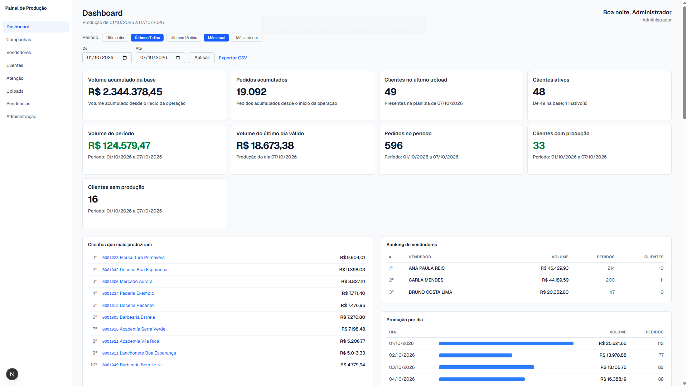
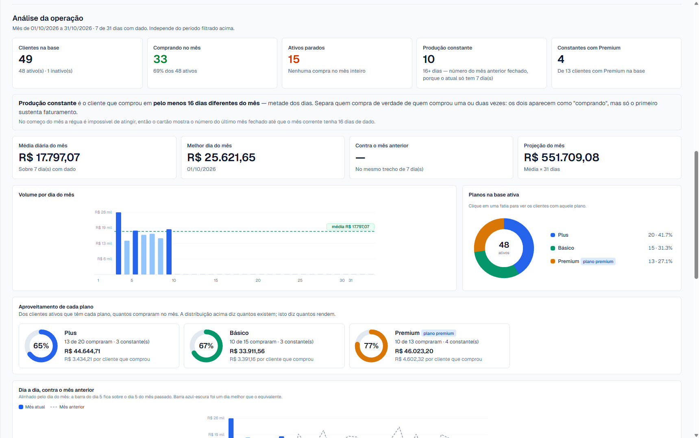
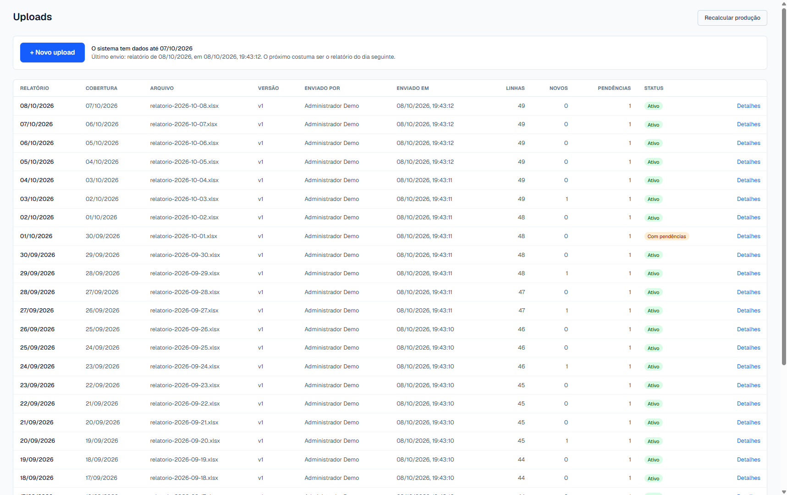
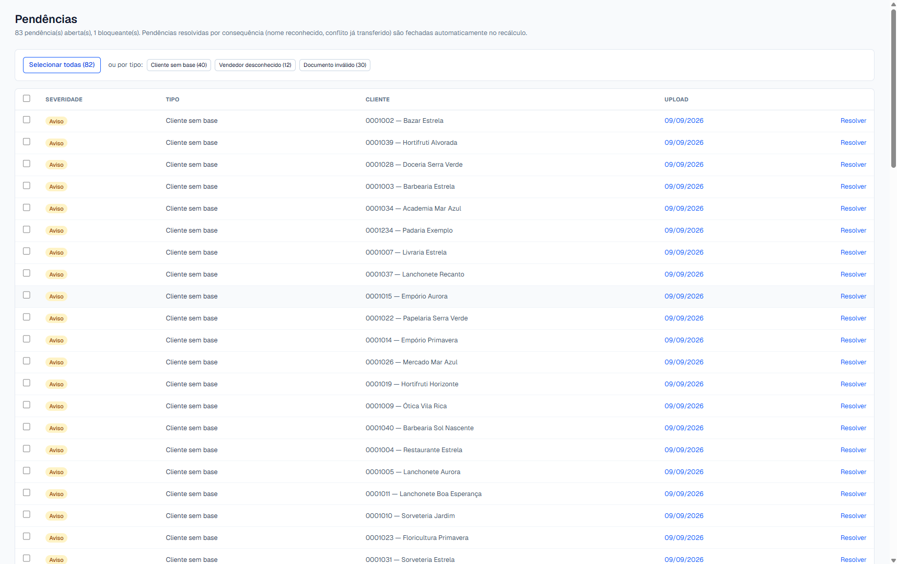
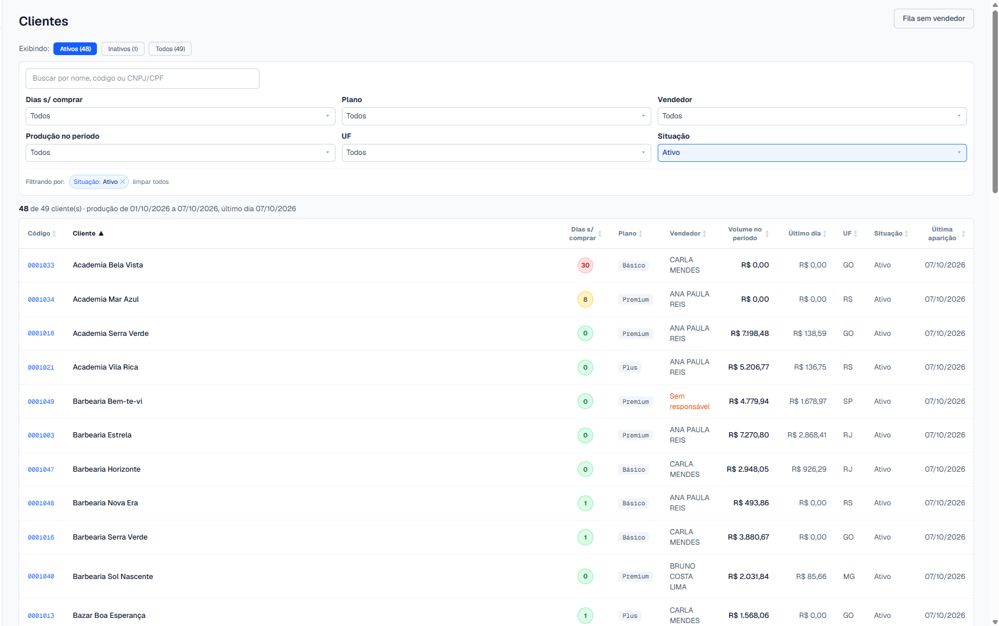
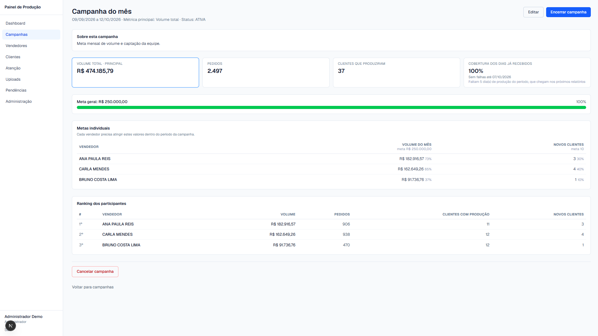
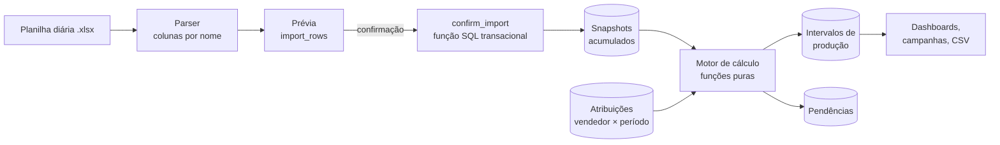
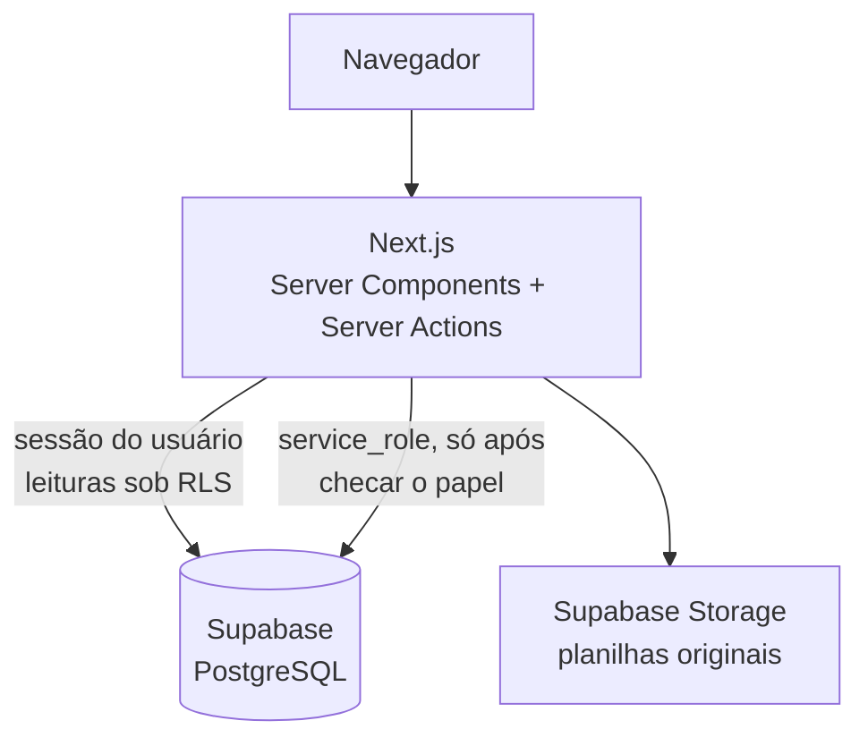

# Painel de Produção

Sistema web que transforma planilhas diárias de valores **acumulados** em produção diária por cliente e por vendedor, com dashboards, campanhas de metas e uma fila de pendências para tudo que não fecha.



## Contexto

A equipe comercial recebia todo dia um relatório em Excel com o total acumulado de cada cliente desde o início do relacionamento: volume em reais, quantidade de pedidos, data da última compra e vendedor responsável. O relatório chegava, mas **ninguém analisava**. Ele não dizia quanto cada cliente comprou *naquele dia*, quem estava parando de comprar nem como cada vendedor estava em relação à meta. Tirar isso à mão exigiria comparar planilhas linha a linha, todos os dias.

O desafio técnico é que o dado de origem não é a produção, é o acumulado. A produção precisa ser **deduzida** pela diferença entre dois relatórios seguidos, e a fonte não é perfeita: há dias sem relatório, clientes que somem e voltam, correções para baixo, nomes de vendedor escritos de formas diferentes e documentos sem os zeros à esquerda que o Excel comeu.

## O que o sistema faz

- **Upload diário com prévia.** O sistema lê a planilha pelo nome das colunas (nunca pela posição), deduz a data que ela cobre e mostra o que vai mudar antes de gravar: clientes novos, ausentes, valores que diminuíram e vendedores desconhecidos.
- **Cálculo da produção.** A produção diária é a diferença entre relatórios consecutivos. Dias sem relatório viram um intervalo agregado, que nunca é dividido artificialmente entre os dias. A carga inicial não conta como produção.
- **Pendências em vez de bloqueios.** Inconsistências da fonte (valor negativo, documento inválido, vendedor desconhecido, troca de responsável) viram itens para decisão humana, com resolução individual ou em lote.
- **Carteira por vendedor.** Cada cliente tem uma linha do tempo de responsáveis, com transferência por data efetiva, fila de clientes sem vendedor e apelidos para os nomes que a fonte escreve errado.
- **Dashboards.** Produção do período, ranking de vendedores, análise mensal (produção constante, clientes parados, concentração, aproveitamento por plano) e detalhamento clicável: todo número da tela abre a lista de clientes que o compõe.
- **Campanhas de metas** com metas por vendedor (volume, pedidos, novos clientes) e ranking.
- **Atenção.** Lista de clientes que pararam de comprar, com alerta por faixa de dias.
- **Três papéis.** Administrador, gestor e vendedor. O vendedor vê só a própria carteira.
- **Auditoria** das ações administrativas e **exportação** da produção em CSV.

| | |
|---|---|
|  |  |
| Análise mensal da operação | Histórico de uploads diários |
|  |  |
| Fila de pendências | Carteira de clientes com filtros |



## Resultado

O sistema está em uso desde agosto de 2026, com cerca de 20 vendedores e 3 gestores. O relatório diário, que antes chegava e não era analisado, passou a dar à gestão uma **visão ampla da operação**: quem está comprando, quem parou, como cada vendedor está em relação à meta e quais planos rendem mais. Esses dados viraram a base para discutir estratégias da operação.

## Stack e arquitetura

- **Next.js 16** (App Router, Server Components e Server Actions) + **React 19** + **TypeScript**
- **Tailwind CSS 4**
- **Supabase**: PostgreSQL com Row Level Security, Auth e Storage para os arquivos enviados
- **SheetJS** para ler Excel no servidor
- **Vitest** para os testes do parser e do motor de cálculo
- Gráficos em **SVG desenhados no servidor**, sem biblioteca de terceiros (compatível com uma CSP estrita, com nonce)





## Decisões técnicas

**1. A produção é a diferença entre snapshots acumulados.** A planilha traz totais acumulados, não o movimento do dia. Cada upload vira um snapshot imutável por cliente, e a produção é calculada pela diferença entre snapshots consecutivos. Isso deixa cada número rastreável até os dois relatórios que o geraram. Também permite tratar com regra explícita os casos difíceis: dia sem relatório (intervalo agregado), cliente novo (o acumulado é lançado na data da última compra informada, exceto na carga inicial) e correção negativa (pendência bloqueante, nada é lançado).

**2. Confirmação transacional e recálculo por reconstrução completa.** A API do Supabase não oferece transação entre várias requisições, então a confirmação de upload é uma função PL/pgSQL que grava tudo ou nada, com *advisory lock* por data contra confirmações simultâneas. A produção não é atualizada aos poucos: a tabela de intervalos é apagada e reconstruída a cada recálculo, numa única transação. Recalcular duas vezes dá o mesmo resultado (idempotência), e mudar uma regra não deixa dados antigos inconsistentes. A regra de negócio fica no motor de cálculo, em **funções puras** sem acesso ao banco, que é o que os testes cobrem.

**3. Permissão em duas camadas.** Toda página e toda ação conferem o papel do usuário no servidor, e o PostgreSQL repete a regra com Row Level Security. O vendedor só enxerga a própria carteira mesmo que a interface falhe. O papel nunca vem de dado que o próprio usuário consegue preencher: o cadastro sempre cria o perfil com o menor privilégio, e a promoção é feita pelo backend.

## Como rodar

Pré-requisitos: **Node.js 20+** e **Docker Desktop** (para o Supabase local).

```bash
# 1. Dependências
npm install

# 2. Supabase local (a primeira vez baixa as imagens; as migrations são aplicadas automaticamente)
npx supabase start

# 3. Variáveis de ambiente: copie o exemplo e preencha com os valores de `npx supabase status`
cp .env.example .env.local

# 4. Dados de demonstração: gera 30 dias de planilhas fictícias e processa cada uma
#    pelo mesmo fluxo de um upload real
npm run seed

# 5. Aplicação em http://localhost:3000
npm run dev
```

Usuários criados pelo seed (senha `demo12345`):

| E-mail | Papel |
|---|---|
| `admin@demo.local` | Administrador |
| `gestor@demo.local` | Gestor |
| `vendedor@demo.local` | Vendedor (vê só a própria carteira) |

Para recomeçar do zero: `npx supabase db reset` e `npm run seed`.

**Testes:**

```bash
npm test
```

Os testes cobrem o parser, o motor de cálculo, a correção de datas de atribuição, a classificação de erros de login e a prévia de upload. Os de ponta a ponta usam as planilhas fictícias de `dados-demo/`, geradas por `scripts/gerar-planilhas.mjs` com semente fixa, e conferem valores exatos (por exemplo, o cliente de referência produz R$ 976,57 em 132 pedidos entre os dois primeiros relatórios).

## Status

Versão demonstrativa de um sistema em produção, com dados fictícios.
